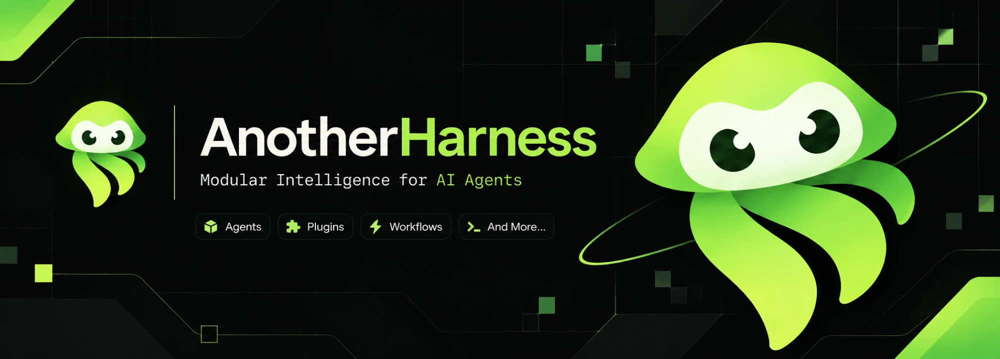

# AnotherHarness

English | [中文](README.zh.md)



AnotherHarness (`ah`) is an open-source agent harness built on an **everything-is-a-plugin** architecture and powered by [Cordis](https://github.com/cordiverse/cordis), whose design is described in [_A Programming Paradigm for Spatiotemporal Composability_](https://arxiv.org/abs/2608.25512).

AnotherHarness is based on [DeepSeek Harness](https://github.com/deepseek-ai/deepseek-harness) by DeepSeek AI, used under the MIT License. It is an independent project and is not affiliated with or endorsed by DeepSeek.

## Developer preview

AnotherHarness is in _developer preview_ and iterating rapidly. **THERE WILL BE COMPATIBILITY-BREAKING CHANGES.**

Review the [safety notice](docs/safety.md) before running the project.

## Run

### Run from source

AnotherHarness runs from a repository checkout. Linux, macOS, and WSL2 are the recommended environments; on Windows, clone inside the WSL filesystem (for example `~/AnotherHarness`), not under `/mnt/c` or `/mnt/d`.

Requirements: Node.js `^22.19.0` or `>=24.0.0` and pnpm `11.28.5`.

```sh
git clone https://github.com/henriqqw/AnotherHarness.git
cd AnotherHarness
pnpm install
pnpm run build
pnpm ah web
```

`pnpm run build` prepares the repository artifacts. `pnpm ah web` uses those built artifacts without rebuilding and starts the Web UI at `http://127.0.0.1:3080`. Pass `--no-open` to run the server without opening a browser. See the [Web UI guide](docs/user/guide/index.md).

### Model credentials

Set `DEEPSEEK_API_KEY` in the launching environment or in a root `.env` file (gitignored), or save the key on the Web UI Models page. Never commit keys.

## Contributing

See [CONTRIBUTING.md](CONTRIBUTING.md). Submit feedback or bug reports through [GitHub Issues](https://github.com/henriqqw/AnotherHarness/issues).

## Development

Start with the [development guide](docs/development.md) and [architecture documentation](docs/architecture.md).

`pnpm run dev:web` builds, serves, and rebuilds client bundles on source edits in one terminal, and `make help` lists the matching Make targets for Web and Desktop; the guide's application commands section owns the full table.

For agents, follow [AGENTS.md](AGENTS.md).

## Acknowledgements

AnotherHarness started from the DeepSeek Harness source code. Credit for the original architecture and implementation belongs to DeepSeek AI and the DeepSeek Harness contributors.

## License

[MIT](LICENSE). The original DeepSeek copyright notice is preserved as the license requires.

Third-party dependencies and their licenses are disclosed in [THIRD_PARTY_NOTICES.md](THIRD_PARTY_NOTICES.md).
