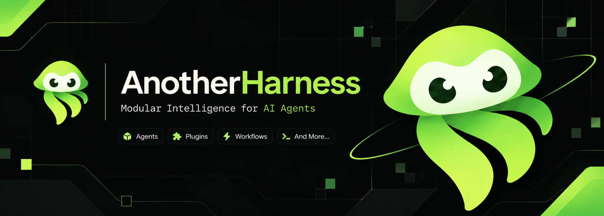

# AnotherHarness

[English](README.md) | 中文



AnotherHarness（`ah`）是一个开源 agent harness（智能体框架），采用**一切皆插件**的架构，由 [Cordis](https://github.com/cordiverse/cordis) 驱动，其设计见论文 [_A Programming Paradigm for Spatiotemporal Composability_](https://arxiv.org/abs/2608.25512)。

AnotherHarness 基于 DeepSeek AI 的 [DeepSeek Harness](https://github.com/deepseek-ai/deepseek-harness)，依据 MIT 许可证使用。本项目是独立项目，与 DeepSeek 无隶属关系，也未获其背书。

## 开发者预览

AnotherHarness 处于_开发者预览_阶段，迭代迅速。**会有破坏兼容性的变更。**

运行项目前请阅读[安全须知](docs/safety.zh.md)。

<a id="run"></a>

## 运行

<a id="run-from-source"></a>

### 从源码运行

AnotherHarness 从仓库检出运行。推荐使用 Linux、macOS 或 WSL2；在 Windows 上请克隆到 WSL 文件系统内（例如 `~/AnotherHarness`），不要放在 `/mnt/c` 或 `/mnt/d` 下。

要求：Node.js `^22.19.0` 或 `>=24.0.0`，以及 pnpm `11.28.5`。

```sh
git clone https://github.com/henriqqw/AnotherHarness.git
cd AnotherHarness
pnpm install
pnpm run build
pnpm ah web
```

`pnpm run build` 准备仓库构建产物。`pnpm ah web` 直接使用这些产物而不重新构建，并在 `http://127.0.0.1:3080` 启动 Web UI。传入 `--no-open` 可只启动服务而不打开浏览器。参见 [Web UI 指南](docs/user/guide/index.zh.md)。

### 模型凭据

在启动环境或根目录 `.env` 文件（已被 gitignore）中设置 `DEEPSEEK_API_KEY`，或在 Web UI 的 Models 页面保存密钥。切勿提交密钥。

## 贡献

参见 [CONTRIBUTING.zh.md](CONTRIBUTING.zh.md)。通过 [GitHub Issues](https://github.com/henriqqw/AnotherHarness/issues) 提交反馈或缺陷报告。

## 开发

从[开发指南](docs/development.zh.md)和[架构文档](docs/architecture.zh.md)开始。

`pnpm run dev:web` 在一个终端中完成构建、启动服务，并在源码修改时重新构建客户端 bundle；`make help` 列出 Web 与 Desktop 对应的 Make 目标，完整列表见指南中的应用命令一节。

智能体请遵循 [AGENTS.md](AGENTS.md)。

## 致谢

AnotherHarness 起始于 DeepSeek Harness 源代码。原始架构与实现归功于 DeepSeek AI 及 DeepSeek Harness 的贡献者。

## 许可证

[MIT](LICENSE)。按照许可证要求，保留了 DeepSeek 的原始版权声明。

第三方依赖及其许可证见 [THIRD_PARTY_NOTICES.md](THIRD_PARTY_NOTICES.md)。
